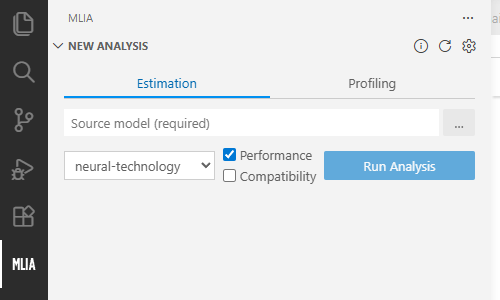
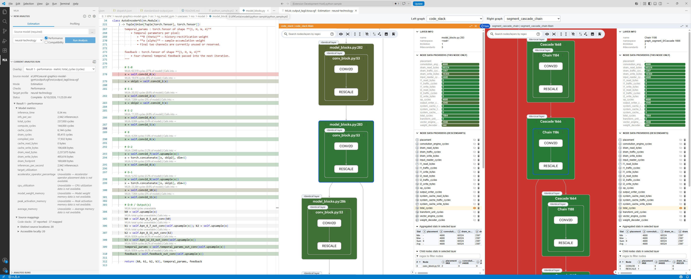

<!---
SPDX-FileCopyrightText: Copyright 2026 Arm Limited and/or its affiliates <open-source-office@arm.com>
SPDX-License-Identifier: Apache-2.0
--->

# MLIA for VS Code

Run [MLIA](https://github.com/arm/mlia) performance analyses and explore model results without leaving Visual Studio Code.

## Features

- Configure and launch MLIA estimation and profiling analyses.
- Track running, completed, and failed analysis runs.
- Explore results in [Model Explorer](https://github.com/google-ai-edge/model-explorer).
- Navigate between Model Explorer nodes and source code.
- Display metrics with CodeLens and source heatmaps.

## Getting started

1. Open the **MLIA** view in the Activity Bar.
2. In **New Analysis**, refresh the managed MLIA environment if prompted, then select **Estimation** or **Profiling** and provide the required model or profiling data.
3. Select a target profile and the checks to run.

4. Select **Run Analysis**.
5. Model Explorer opens with a loading view while the analysis runs. When it completes, the generated result appears and **Current Analysis Run** displays its summary metrics.

See the [user guide](docs/users/README.md) for installation, configuration, and troubleshooting.

## Documentation

- [User documentation](docs/users/README.md)
- [Contributor documentation](docs/contributors/README.md)
- [Design documentation](docs/design/README.md)

## Development

See the [contributor guide](docs/contributors/README.md).

## Feedback and issues

Report defects and feature requests through the repository's [issue tracker](https://github.com/Arm/mlia-vscode/issues).

## License

Licensed under the [Apache License 2.0](LICENSE).
