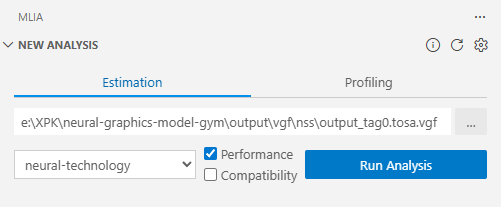
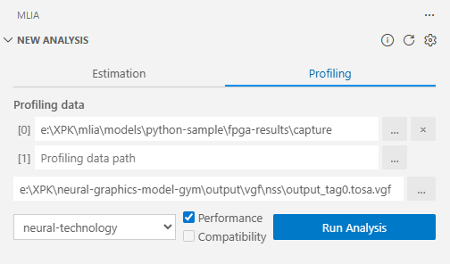
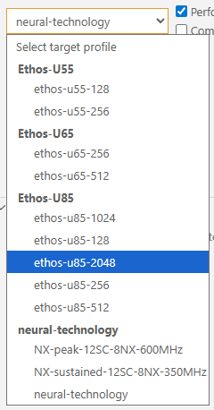
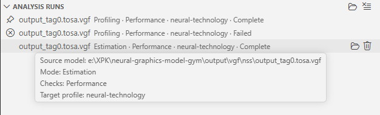

<!---
SPDX-FileCopyrightText: Copyright 2026 Arm Limited and/or its affiliates <open-source-office@arm.com>
SPDX-License-Identifier: Apache-2.0
--->

# Running analyses

MLIA for VS Code supports estimation and profiling workflows. The selected mode and target profile determine which checks you can run.

## Analysis modes

| Mode | Required input | Optional input | Typical use |
| --- | --- | --- | --- |
| **Estimation** | One source model | None | Estimate compatibility or performance before collecting runtime profiling data. |
| **Profiling** | One or more [profiling-data paths](profiling-data.md) | Source model | Analyse measured profiling data, optionally associating it with the original model. |

## Estimation

Use **Estimation** to evaluate a source model for a target profile.

1. Select or enter the **Source model** path.
2. Select a target profile.
3. Enable one or more supported checks.
4. Select **Run Analysis**.

The source model is required in estimation mode.

## Profiling

Use **Profiling** after collecting [profiling data](profiling-data.md) from your target.

1. Add one or more profiling-data paths.
2. Reorder or remove profiling-data entries when necessary.
3. Optionally select the source model.
4. Select a target profile.
5. Enable one or more supported checks.
6. Select **Run Analysis**.

At least one profiling-data path is required. Multiple paths are passed to MLIA in their displayed order.

Depending on the profiling format, a source model can add context to MLIA and Model Explorer.

## Target profiles

Target profiles describe the inference target and configuration against which MLIA evaluates the input.

The target profiles shown in New Analysis depend on the selected analysis mode.

The most recently selected profile is remembered for subsequent analyses. Changing the configured profile does not affect saved runs.

If no profiles are shown:

1. Refresh the MLIA environment.
2. Check the MLIA output log for errors.
3. See [Troubleshooting](troubleshooting.md).

## Checks

The extension exposes two MLIA check categories:

- **Performance** evaluates performance-related metrics and recommendations for the selected profile.
- **Compatibility** checks whether the input is supported by the selected profile.

A check is disabled when it is not supported for the selected mode and profile. At least one supported check must be enabled before an analysis can start.

## What happens when an analysis starts

The extension runs MLIA in its managed environment and creates a dedicated output directory for the run. It requests:

- MLIA standardized output.
- A Model Explorer bundle.
- Mappings that connect MLIA results to Model Explorer nodes.
- Debug output for diagnostics.

Each run records its input paths, mode, selected checks, target profile, status, output, and selected overlay. Completed and failed runs are persisted across VS Code sessions.

## Managing runs

The **Analysis Runs** view lists saved runs with their current status.

Available actions include:

- Select a run to make it current.
- Cancel a running analysis started by the current extension session.
- Open a run's output folder.
- Delete a finished run.
- Open the root analysis-runs folder.
- Clear all saved runs.

Deleting a run also removes its stored output directory.

## Advanced arguments

The [`vscode-mlia.extraCommandLineArgs`](configuration.md#extra-command-line-args) setting appends arguments unchanged to the generated `mlia check` command. Use this only when an option is not represented in the extension interface.

Extra arguments can override or conflict with extension-managed arguments. Review the [MLIA CLI Guide](https://github.com/arm/mlia/blob/main/docs/source/cli.md#backend-specific-options) and inspect the MLIA output log when using this setting.

Next: [explore completed runs, Model Explorer, and overlays](results.md).
