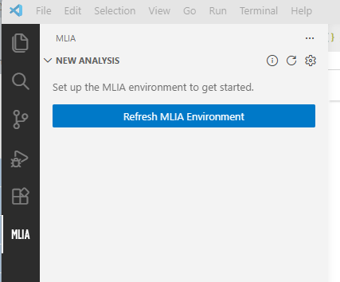
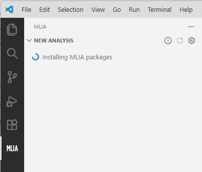

<!---
SPDX-FileCopyrightText: Copyright 2026 Arm Limited and/or its affiliates <open-source-office@arm.com>
SPDX-License-Identifier: Apache-2.0
--->

# Installation and requirements

MLIA for VS Code runs MLIA in an isolated Python environment managed by the extension. You do not need to install MLIA separately.

## Requirements

You need:

- Visual Studio Code 1.100 or newer.
- Network access while the extension downloads its runtime tools and packages.
- A model or profiling data for the analysis.

The extension installs and manages `uv`, Python, and MLIA.

## Install the extension

Install **MLIA** from the Visual Studio Marketplace.

To install a local or pre-release VSIX package instead:

1. Open the **Extensions** view in VS Code.
2. Open the view's **More Actions** menu.
3. Select **Install from VSIX...**.
4. Select the `.vsix` package.

You can also install a VSIX from a terminal:

```sh
code --install-extension vscode-mlia-<version>.vsix
```

## Create the managed MLIA environment

1. Open the **MLIA** view from the Activity Bar.
2. Select **Refresh MLIA Environment**.
3. Wait while the extension creates and verifies the managed MLIA environment and loads the analysis options.



During setup, the view reports the current stage:



The first refresh may take longer while the required tools and packages are downloaded. Later refreshes reuse and synchronize the managed environment.

The extension stores this environment in its VS Code global storage area. It does not modify your project environment or an existing Python virtual environment.

## Refresh or repair the environment

Select **Refresh MLIA Environment** from the New Analysis title bar when:

- The extension has just been installed;
- Environment setup was interrupted or failed;
- Analysis options are missing;
- The New Analysis view reports that environment information is unavailable.

If an ordinary refresh does not resolve an environment problem, run **MLIA: Force Refresh MLIA Environment**. This deletes and recreates the managed environment and reinstalls its packages.

If a refresh fails, select **Show Log** in New Analysis, or open VS Code's **Output** panel and select **MLIA**. See [Troubleshooting](troubleshooting.md).

Next, [create and export a VGF model](creating-vgf-model.md) if needed. If you already have one, either [run an estimation](analyses.md) or [collect profiling data](profiling-data.md) for measured performance.
