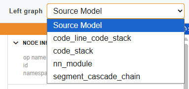
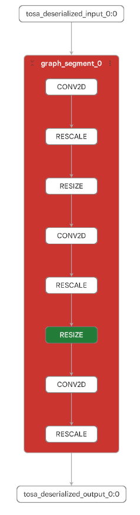
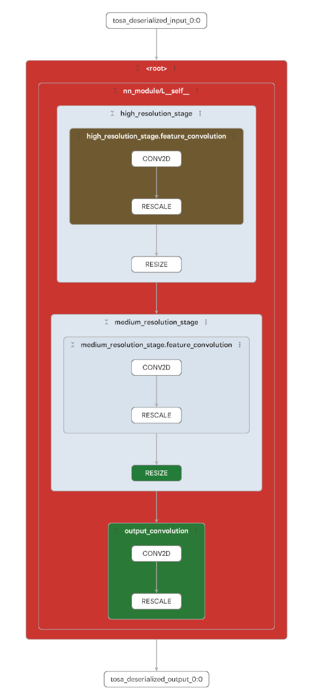
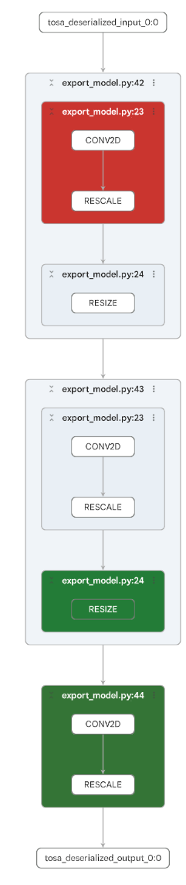
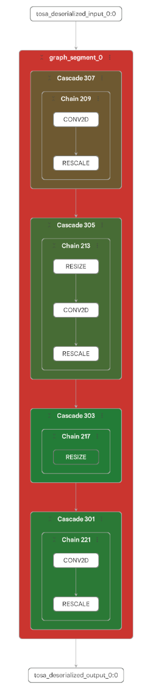

<!---
SPDX-FileCopyrightText: Copyright 2026 Arm Limited and/or its affiliates <open-source-office@arm.com>
SPDX-License-Identifier: Apache-2.0
--->

# Model Explorer representations

MLIA produces several graph representations of your model. Each representation groups nodes differently to help you understand the analysis results. Metrics are aggregated according to these groupings, so you can quickly identify which parts of the model to focus on.

Use the graph selector in Model Explorer to switch between the available representations:

## Source Model

**Source Model** is always available. It shows the original model together with the groupings that Model Explorer normally provides for that model format, such as the different segments within a VGF model.

## Additional representations

The other representations available depend on the model format, the selected target profile, and the data included with the model or analysis.

### `nn_module`

Available for models authored in Python when the required module information is present. This representation groups nodes according to the PyTorch `nn.Module` hierarchy, helping you relate results to the structure of the original model implementation.

### `code_stack`

Available for models with source-code information. This representation groups nodes hierarchically according to the call stack from which each operator was created, helping you trace results back through the source code.

### `segment_cascade_chain`

Available for models compiled into cascades and chains for execution on the target hardware. This hardware-centric representation groups operators by the lower-level units that the hardware executes, providing a more faithful view of performance.

