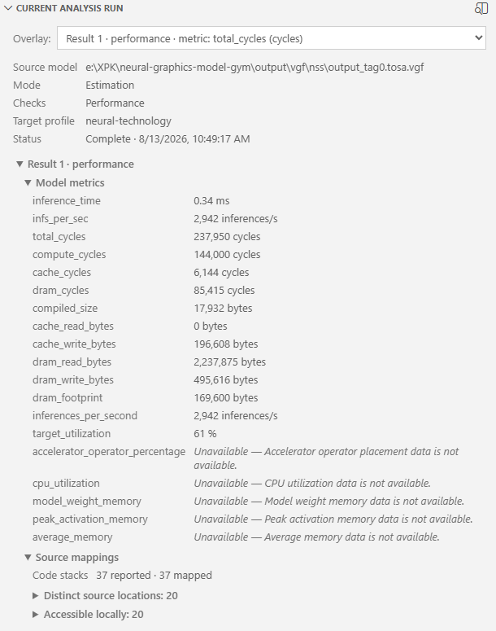
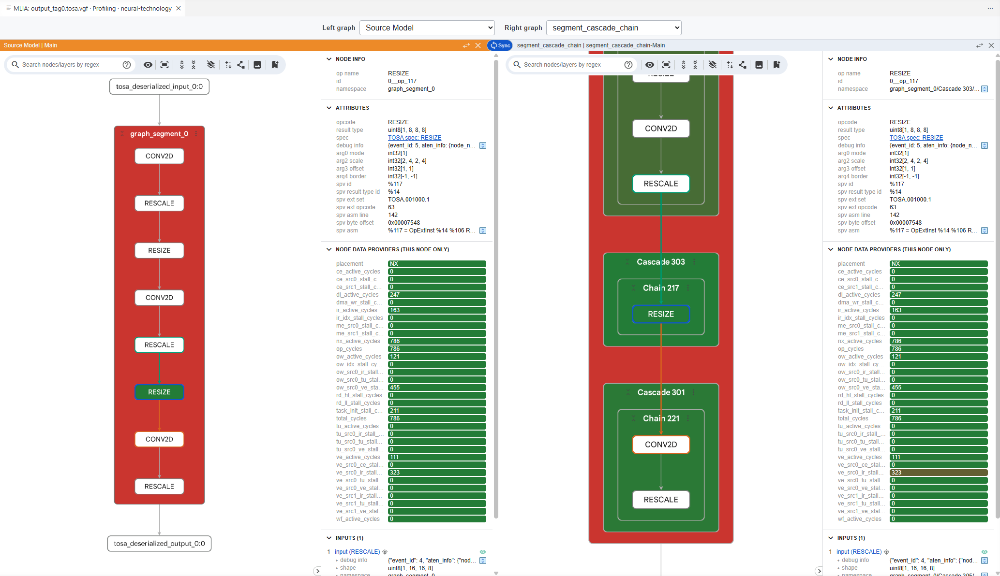
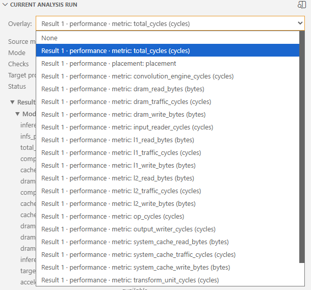

<!---
SPDX-FileCopyrightText: Copyright 2026 Arm Limited and/or its affiliates <open-source-office@arm.com>
SPDX-License-Identifier: Apache-2.0
--->

# Exploring analysis results

A completed analysis appears in three places:

- **Current Analysis Run** summarizes the selected run and controls the active overlay.
- **Model Explorer** provides interactive model and analysis graphs.
- Source editors display mapped metrics, heatmaps, and navigation actions.

## Automatic opening

By default, the extension opens a Model Explorer panel when an analysis starts and replaces its loading view with the generated result when MLIA completes.

Set [`vscode-mlia.autoOpenModelExplorer`](configuration.md#auto-open-model-explorer) to `false` if you do not want panels to open automatically. Completed runs are still saved. To open a saved result later, select its entry in **Analysis Runs**.

## Current Analysis Run

The Current Analysis Run view follows the selected run, including running and failed runs. It shows **Cancel Analysis** for running analyses owned by this extension session, and **Show MLIA Log** for runs without completed results. This log is the shared output for the current extension session, not an archived per-run log.

Selecting a run without completed results clears the previous run's source heatmaps and CodeLens. They become available again when the selected run completes successfully or you select a completed run.

The view shows:

- Source-model and profiling-data paths.
- Estimation or profiling mode.
- Enabled checks.
- Target profile.
- Run status and completion time.
- Model-level result metrics.
- Source-mapping diagnostics.
- The active result overlay.

The displayed metrics summarize the whole model rather than an individual graph node. The source-mapping section lists embedded source locations and whether they are available locally. See [Source-file mapping](source-file-mapping.md) to resolve embedded paths. Expand **Accessible locally** and select a line number to open it.

Runs may contain multiple MLIA results. Metrics and source mappings are grouped by result number and result kind.

Unavailable metrics include an explanation when MLIA reports one. Large numeric values are shortened for display; hover over a value to see its full precision.

## Model Explorer

Model Explorer opens beside the editor and displays interactive graph views generated from the source model and MLIA results. Depending on the model and analysis, you may be able to switch between the original model structure and additional hierarchy views, such as source-code or framework groupings.

Use the graph selectors to switch between the [available representations](model-explorer-representations.md):

Use Model Explorer to:

- Pan and zoom around large graphs. Press `Space` or use [Fit to screen](https://github.com/google-ai-edge/model-explorer/wiki/2.-User-Guide#graph-navigation) on the toolbar to show the whole graph.
- Expand or collapse individual layers to choose the required level of detail. Use the toolbar controls to [expand or collapse all layers](https://github.com/google-ai-edge/model-explorer/wiki/2.-User-Guide#expandcollapse-all-layers), including nested layers. Expanding every layer may take some time for large graphs.
- Search operation names, attributes, and input or output metadata.
- Select a node to inspect its attributes, connections, inputs, outputs, and MLIA data.
- Highlight model inputs and outputs and inspect repeated structures.

Selecting an MLIA overlay adds values and colours to the relevant graph nodes. By default, the extension keeps overlay selections in sync between Model Explorer and Current Analysis Run, and opens the local source for a mapped node.

The extension maintains the association between a Model Explorer panel and its saved analysis. Reopening a saved run restores the generated graph views and analysis data.

For more detail, see the [MLIA Model Explorer plugin documentation](https://github.com/arm/mlia-model-explorer) and the [Google Model Explorer User Guide](https://github.com/google-ai-edge/model-explorer/wiki/2.-User-Guide).

## Overlays

The **Overlay** selector in Current Analysis Run lists overlays found in MLIA standardized output. Depending on the result, overlays can represent metrics or other presentation categories.

Selecting an overlay in either Current Analysis Run or Model Explorer synchronizes it across:

- The Current Analysis Run selector.
- The corresponding Model Explorer panel.
- Source heatmap colours.
- Source CodeLens values.

Choose **None** to clear the active overlay.

Overlay selections are saved with each run.

## Model Explorer and source navigation

When [`vscode-mlia.syncModelExplorerSelectionToCode`](configuration.md#sync-model-explorer-selection-to-code) is enabled, selecting a mapped Model Explorer node opens its corresponding source location when one can be resolved unambiguously.

Source navigation works only when a selected node maps to one local file and line. The extension does not navigate when:

- The node has no source mapping.
- The mapping has no valid file or line.
- The node maps to more than one source location.
- The source file is not available locally.

Configure [source-file mapping](source-file-mapping.md) when the embedded source-code locations do not match the paths on your machine.

Next: [display analysis data in local source files](source-visualisation.md).
