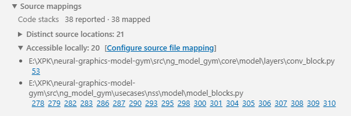

<!---
SPDX-FileCopyrightText: Copyright 2026 Arm Limited and/or its affiliates <open-source-office@arm.com>
SPDX-License-Identifier: Apache-2.0
--->

# Source-file mapping

MLIA results can contain source paths embedded by a build machine, container, CI worker, or another checkout. Source-file mapping translates those paths to files on your machine.

Configure mappings with [`mlia-vscode.sourceFileMap`](configuration.md#source-file-map).

## Mapping format

The setting is an object whose keys are embedded source prefixes and whose values are local path prefixes:

```json
{
  "mlia-vscode.sourceFileMap": {
    "/root/build/project": "C:/src/project"
  }
}
```

This maps:

```text
/root/build/project/src/model.cpp
```

to:

```text
C:/src/project/src/model.cpp
```

Both `/` and `\` separators in embedded paths are accepted.

## Absolute-path mappings

Use an absolute embedded prefix when the debug information contains an absolute build-machine path:

```json
{
  "mlia-vscode.sourceFileMap": {
    "/home/ci/ml-project": "D:/work/ml-project"
  }
}
```

The extension preserves the path suffix after the matched prefix.

## Relative-path mappings

Mappings can also match relative source paths:

```json
{
  "mlia-vscode.sourceFileMap": {
    "src/model": "D:/work/ml-project/model"
  }
}
```

This maps `src/model/operator.cpp` to `D:/work/ml-project/model/operator.cpp`.

## Matching rules

- A prefix matches the complete path or a path-segment boundary.
- Trailing separators on configured prefixes are ignored.
- When multiple entries match, the longest source prefix wins.
- The unmatched suffix is appended to the local prefix.
- The final path is normalized for the local operating system.

Example with overlapping prefixes:

```json
{
  "mlia-vscode.sourceFileMap": {
    "/build": "D:/source",
    "/build/generated": "D:/generated-source"
  }
}
```

`/build/generated/model.cpp` uses the second, more specific mapping.

## Find paths that need mapping

1. Complete an analysis and open **Current Analysis Run**.
2. Expand the result's **Source mappings** section.
3. Expand **Distinct source locations** to see the embedded source paths.
4. Compare them with **Accessible locally**.
5. Select **Configure source file mapping** when inaccessible locations are reported.



After changing the setting, the current source mapping index is rebuilt automatically.

## Troubleshooting mappings

If a path still does not resolve:

- Ensure the source prefix matches from the beginning of the embedded path.
- Check directory boundaries and spelling.
- Use forward slashes in JSON to avoid escaping Windows backslashes.
- Verify that the resulting file exists locally.
- Add a more specific mapping when multiple build roots share a prefix.
- Confirm that the code-stack data contains a positive source line number.

A mapped file can be accessible even when it is outside the currently opened workspace.

See [Troubleshooting](troubleshooting.md) if the environment, analyses, Model Explorer, or source presentation still fail.
