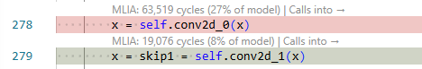

<!---
SPDX-FileCopyrightText: Copyright 2026 Arm Limited and/or its affiliates <open-source-office@arm.com>
SPDX-License-Identifier: Apache-2.0
--->

# Source-code visualisations

MLIA for VS Code can show metrics in the source code that produced them.

## Requirements

Source presentation is available when the completed MLIA result contains:

- Code-stack data with valid `file` and `line` attributes.
- Mappings that connect MLIA results to Model Explorer nodes.
- Local source files matching the embedded paths, either directly or through [`vscode-mlia.sourceFileMap`](configuration.md#source-file-map).

The Current Analysis Run view reports the number of code stacks, mapped code stacks, distinct source locations, and locations accessible on the local machine.

## Heatmaps

When an overlay is selected, the extension maps its values to colours and applies them to mapped lines in visible source editors. Numeric metrics use a relative green-to-red scale across the mapped lines, while other overlay categories use fixed colours.

The heatmap updates when you:

- Select another overlay.
- Make another completed run current.
- Open another mapped source file.
- Change source-file mappings.

Disable heatmaps with [`vscode-mlia.showHeatmap`](configuration.md#show-heatmap).

## CodeLens metrics

CodeLens entries can appear above mapped source lines. For the selected overlay, they show:

- The metric or presentation value, or that it is unavailable.
- The source line's percentage of the model total when it can be calculated safely.
- An action that selects the source line's associated node in Model Explorer.
- Caller and called-source actions that navigate to related source lines when available.

Hover over a CodeLens entry for details about unavailable metric data.

Disable these entries with [`vscode-mlia.showCodeLens`](configuration.md#show-code-lens).

## Navigate from source to Model Explorer

Select a metric or presentation CodeLens entry to select the source line's associated node in Model Explorer.

Caller and called-source CodeLens actions open the related source line and synchronize the corresponding Model Explorer selection.

## Navigate from Model Explorer to source

With [`vscode-mlia.syncModelExplorerSelectionToCode`](configuration.md#sync-model-explorer-selection-to-code) enabled, selecting a mapped node in Model Explorer opens the resolved source file and briefly highlights the corresponding line.

The extension preserves Model Explorer focus where possible and opens source in another editor group.

## Select overlays

Use the **Overlay** selector in Current Analysis Run or select a data overlay in Model Explorer. The selection is synchronized across Model Explorer, CodeLens, and heatmaps.

If source highlighting or CodeLens is disabled, Current Analysis Run displays a warning and provides a shortcut to MLIA settings.

Next: [configure the extension and its analysis defaults](configuration.md).
